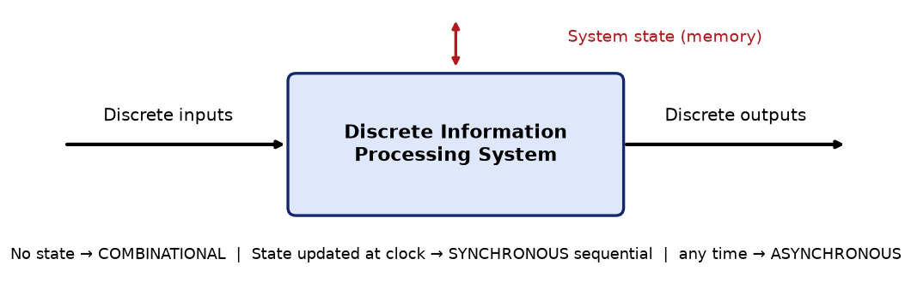
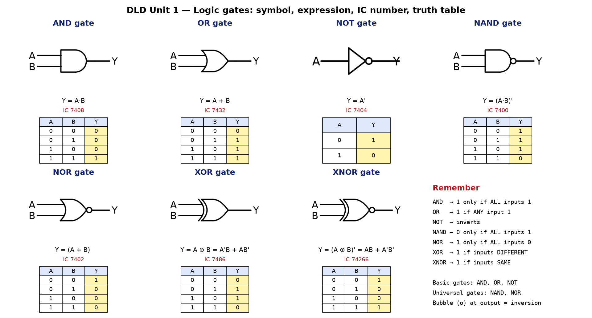
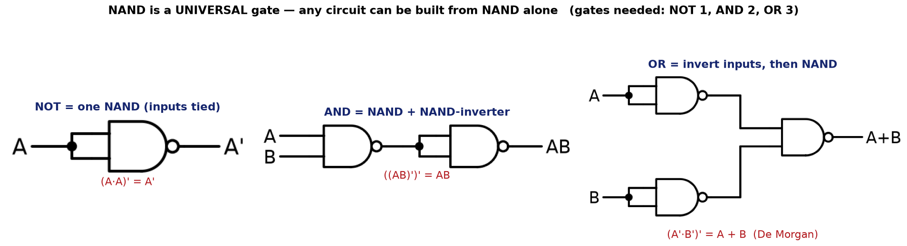
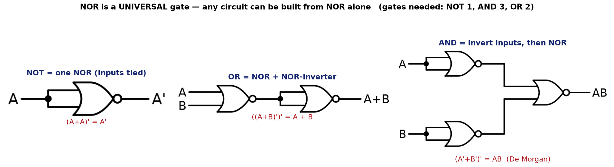
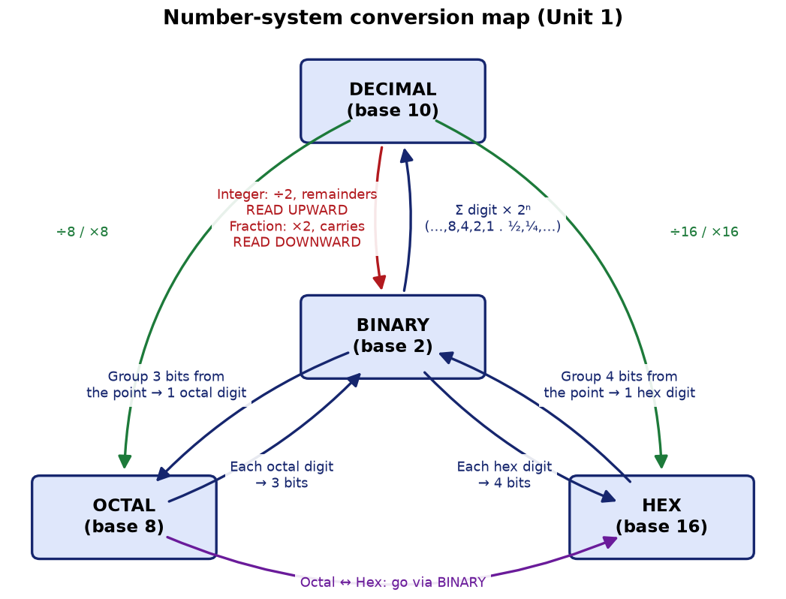

# DLD · Unit 1 — Number Systems & Logic Gates  (Weightage 15 %)
> **Professor's class notes** — built from: `Unit-1 ppt.pdf` (76 slides), `Unit 1 Solved Examples.pdf` (18 handwritten pages),
> `DLD Assignment_1.pdf` (Module 1 part), syllabus. Topics marked ⚠ are in the **syllabus** but not in the class material,
> so they're covered from standard textbook knowledge.
>
> **How to study this file:** read one section → answer its *✋ Check yourself* questions without looking → continue.
> Total time ≈ 2.5 h (first pass).

---
## 0. Roadmap
| # | Topic | Exam frequency |
|---|-------|---------------|
| 1 | Digital systems, signals, analog vs digital | ⭐ (2–3 m) |
| 2 | Logic gates, IC numbers, universal gates | ⭐⭐⭐ (7 m, always asked) |
| 3 | Boolean algebra laws, De Morgan, truth tables, tautology | ⭐⭐⭐ |
| 4 | Number systems & conversions | ⭐⭐⭐ (numericals) |
| 5 | Binary arithmetic (+ − × ÷) | ⭐⭐ |
| 6 | Complements: 1's/2's, r's/(r−1)'s, complement subtraction | ⭐⭐⭐ |
| 7 | Signed numbers & signed addition/overflow ⚠ | ⭐⭐ |
| 8 | Codes: BCD (8421) + BCD addition, Excess-3 ⚠, Gray ⚠, ASCII, EBCDIC | ⭐⭐ |
| 9 | Error detecting & correcting codes: parity, checksum, Hamming ⚠ | ⭐⭐⭐ (7 m) |

---
## 1. Digital Systems — the big picture

**Digital system** = a system that takes a set of **discrete** information inputs and discrete internal information
(the **system state**) and produces a set of **discrete** outputs. *(PPT slide 2)*

**Digital Logic Design (DLD)** = the study of designing circuits that process **binary (0/1)** signals using logic gates, to build
building blocks like adders, multiplexers, flip-flops, counters, memories and finally a whole computer.
*(This is the answer to Assignment Q1 “Explain Digital Logic Design”.)*

### Types of digital systems (PPT slide 3)
| Type | State (memory)? | Output depends on | Example |
|------|-----------------|-------------------|---------|
| **Combinational** | No | present inputs only: Output = f(Input) | adder, MUX, decoder |
| **Synchronous sequential** | Yes, updated at **discrete clock times** | inputs + state | counters, registers |
| **Asynchronous sequential** | Yes, updated **at any time** | inputs + state | latches, ripple counters |

### Signal (slides 5–7)
- A **signal** is an information variable represented by a physical quantity (voltage, current…).
- **Analog** signal: continuous in **value and time** (e.g., microphone output).
- **Digital** signal: **discrete** in value (and time, if synchronous) — usually only **two levels**: binary.
- Binary values are written as 0/1, False/True, Low/High, Off/On. In electronic computers **1 = positive voltage (HIGH)**, **0 = zero voltage (LOW)** — *positive logic*.

| Analog | Digital |
|--------|---------|
| Continuous values | Discrete (0/1) values |
| Affected by noise easily | Noise immune (only 2 levels) |
| Hard to store | Easy to store (memory) |
| e.g. thermometer, old radio | e.g. computer, digital watch |

**Digital computer example (slide 4):** Input (keyboard, mouse, mic) → CPU (Control unit + Datapath) ↔ Memory → Output (LCD, speakers).

> ✋ **Check yourself:** (1) Why is a counter *sequential*? (2) Give one difference between analog and digital signals.

---
## 2. Logic Gates  ⭐⭐⭐

**Logic gate** = an electronic circuit (made of diodes/transistors) that takes **one or more inputs but gives one output**, according to a logical rule.
It *allows or denies* a digital signal. *(slides 11, 25)*

| Gate | Expression | Output is 1 when… | IC |
|------|-----------|-------------------|----|
| AND | Y = A·B | **all** inputs are 1 | 7408 |
| OR | Y = A + B | **any** input is 1 | 7432 |
| NOT (inverter) | Y = A' (Ā) | input is 0 | 7404 |
| NAND | Y = (A·B)' | **not all** inputs are 1 (0 only for 1,1) | 7400 |
| NOR | Y = (A + B)' | **all** inputs are 0 | 7402 |
| XOR | Y = A ⊕ B = A'B + AB' | inputs are **different** (odd number of 1s) | 7486 |
| XNOR | Y = (A ⊕ B)' = AB + A'B' | inputs are **same** (equality detector) | 74266 / 747266 |

- **Basic gates:** AND, OR, NOT. **Universal gates:** NAND, NOR. **Derived/special:** XOR, XNOR.
- **Multiple-input gates (slide 17):** a 4-input AND, Y = ABCD, is 1 only for input 1111 (truth table has 2⁴ = 16 rows).
- Number of rows in a truth table = **2ⁿ** for n inputs.

### Practical applications (slides 26–28)
- **AND – burglar alarm:** alarm rings only when *Alarm switch = ON* **AND** *Person sensor = ON*.
- **OR – doorbell:** rings when *front switch* **OR** *back switch* is pressed.
- **NOT – heater:** when temperature is **NOT** above 20 °C, heating turns ON.

### Universal gates — why NAND and NOR are “universal”
A gate is **universal** if **NOT, AND and OR** (and therefore *every* Boolean function) can be built from it alone.

| Build | Using NAND | Using NOR |
|-------|-----------|-----------|
| NOT | 1 gate (inputs tied): (A·A)' = A' | 1 gate: (A+A)' = A' |
| AND | 2 gates: NAND → NAND-inverter | 3 gates: invert A, invert B, then NOR: (A'+B')' = AB |
| OR | 3 gates: invert A, invert B, then NAND: (A'·B')' = A+B | 2 gates: NOR → NOR-inverter |

**Why it matters:** manufacturers make whole chips using only one gate type → cheaper, simpler fabrication.

> ✋ **Check yourself:** (1) Output of NAND for A=1, B=0? (2) How many NOR gates make an OR gate? (3) Which gate is an “equality detector”?

---
## 3. Boolean Algebra ⭐⭐⭐  (slides 18–38)

Developed by **George Boole** (1815–1864). Algebra of **two values** (True/False = 1/0). Fundamental operators:
**AND** (conjunction, ·), **OR** (disjunction, +), **NOT** (negation, ').

### Laws / theorems (memorise with their names — slides 29–32)
| No. | Law | (a) OR form | (b) AND form |
|-----|-----|-------------|--------------|
| T1 | Properties of 0 | 0 + A = A | 0 · A = 0 |
| T2 | Properties of 1 | 1 + A = 1 | 1 · A = A |
| T3 | Commutative | A + B = B + A | AB = BA |
| T4 | Associative | (A+B)+C = A+(B+C) | (AB)C = A(BC) |
| T5 | Distributive | A(B+C) = AB + AC | A + BC = (A+B)(A+C) |
| T6 | Idempotence | A + A = A | A · A = A |
| T7 | Absorption | A + AB = A | A(A+B) = A |
| T8 | Complement | A + A' = 1 | A · A' = 0 |
| T9 | Involution | (A')' = A | |
| T10 | **De Morgan** | (A + B)' = A' · B' | (A · B)' = A' + B' |

Extra useful identities: **A + A'B = A + B**, **A(A' + B) = AB**, consensus AB + A'C + BC = AB + A'C.

**Duality principle:** swap + ↔ · and 0 ↔ 1 in any true identity → another true identity (that's why every law has an (a) and (b) form).

### De Morgan's theorems (always asked: “State and prove”)
- **Theorem 1:** (A·B)' = A' + B' → *NAND = Bubbled OR* (“break the bar, change the sign”).
- **Theorem 2:** (A+B)' = A'·B' → *NOR = Bubbled AND*.

Proof by truth table:

| A | B | A·B | (A·B)' | A' | B' | A'+B' | A+B | (A+B)' | A'·B' |
|---|---|-----|--------|----|----|-------|-----|--------|-------|
| 0 | 0 | 0 | **1** | 1 | 1 | **1** | 0 | **1** | **1** |
| 0 | 1 | 0 | **1** | 1 | 0 | **1** | 1 | **0** | **0** |
| 1 | 0 | 0 | **1** | 0 | 1 | **1** | 1 | **0** | **0** |
| 1 | 1 | 1 | **0** | 0 | 0 | **0** | 1 | **0** | **0** |
Columns match → both theorems are proved. ∎

### Truth table, tautology, fallacy (slides 20–23)
- **Truth table:** lists the output for **all 2ⁿ** input combinations.
- **Tautology:** expression that is **always 1**. **Fallacy:** always **0**.

PPT example — truth table of **XY + Z**: outputs for XYZ = 000…111 → 0,1,0,1,0,1,1,1.

**PPT Exercise (solved):**
1. (a) X'Y' + X'Y = X'(Y'+Y) = **X'** → rows XY: 00→1, 01→1, 10→0, 11→0.
   (b) X'YZ' + XY' → XYZ = 000:0, 001:0, 010:**1**, 011:0, 100:**1**, 101:**1**, 110:0, 111:0.
   (c) XY'(Z + YZ') + Z' → since Y' forces Y = 0, YZ' = 0, so it's XY'Z + Z' → 000:1, 001:0, 010:1, 011:0, 100:1, 101:1, 110:1, 111:0 (= Z' + XY').
2. P + (PQ)' = P + P' + Q' (De Morgan) = 1 + Q' = **1** → always 1 → **tautology** ✔.
3. (X+Y)' = X'Y' → this is De Morgan's 2nd theorem; verify with the 4-row table above ✔.

> ✋ **Check yourself:** simplify A + AB + A'B. *(Ans: A + B)*

---
## 4. Number Systems & Conversions ⭐⭐⭐  (slides 39–57 + handwritten examples)

**Radix / base** = number of distinct digits in a number system. Every system here is **positional**: digit value = digit × base^position
(positions … 2, 1, 0 . −1, −2 …).

| System | Base | Digits | Example |
|--------|------|--------|---------|
| Binary | 2 | 0, 1 | (1011)₂ |
| Octal | 8 | 0–7 | (257)₈ |
| Decimal | 10 | 0–9 | (9742)₁₀ = 9×10³ + 7×10² + 4×10¹ + 2×10⁰ |
| Hexadecimal | 16 | 0–9, A(10) B(11) C(12) D(13) E(14) F(15) | (2CAE)₁₆ |

Bit = one binary digit · Nibble = 4 bits · Byte = 8 bits · **MSB** = leftmost (highest weight) · **LSB** = rightmost.
Powers of 2 to remember: 1, 2, 4, 8, 16, 32, 64, 128, 256, 512, 1024 (2¹⁰), … 2¹⁵ = 32768.

### 4.1 Decimal → any base r
- **Integer part:** divide by r repeatedly, write remainders, **read bottom-to-top** (reverse order).
- **Fraction part:** multiply by r repeatedly, take the integer carry, **read top-to-bottom** (forward order). Stop when the fraction becomes 0 or after 4–5 digits.

**Example (43)₁₀ → binary:** 43/2 = 21 r1, 21/2 = 10 r1, 10/2 = 5 r0, 5/2 = 2 r1, 2/2 = 1 r0, 1/2 = 0 r1 → read up → **(101011)₂**.

**Example (37.31)₁₀:** 37 → 100101. Fraction: .31×2 = 0.62→0, .62×2 = 1.24→1, .24×2 = 0.48→0, .48×2 = 0.96→0, .96×2 = 1.92→1 → **(100101.01001…)₂**

**Example (172.878)₁₀ → octal:** 172/8 = 21 r4, 21/8 = 2 r5, 2/8 = 0 r2 → 254. Fraction: .878×8 = 7.024→7, .024×8 = 0.192→0, .192×8 = 1.536→1, .536×8 = 4.288→4 → **(254.7014)₈**

**Example (2479.859)₁₀ → hex (PPT):** 2479 = 9AF; .859×16 = 13.744→D, .744×16 = 11.904→B, .904×16 = 14.464→E, .464×16 = 7.424→7, .424×16 = 6.784→6 → **(9AF.DBE76)₁₆**

### 4.2 Any base r → decimal: multiply each digit by its weight and add
- (1101.000101)₂ = 8+4+0+1 + 1/16 + 1/64 = **13.078125**
- (22.34)₈ = 2×8 + 2 + 3/8 + 4/64 = **18.4375**
- (761.12)₈ = 448 + 48 + 1 + 0.125 + 0.03125 = **497.15625**
- (7CA3)₁₆ = 7×4096 + 12×256 + 10×16 + 3 = **31907**
- (81.21)₁₆ = 128 + 1 + 2/16 + 1/256 = **129.12890625**
  ⚠ *The handwritten notes write 2×16⁻² here (giving 129.1328), but the last digit is 1, so it's 1×16⁻² → 129.1289.*

### 4.3 Binary ↔ Octal ↔ Hex (shortcut, because 8 = 2³ and 16 = 2⁴)
- **Binary → octal:** group **3 bits** from the binary point (left for the integer, right for the fraction; pad with 0s). (1101101.11001)₂ = 001 101 101 . 110 010 = **(155.62)₈**
- **Octal → binary:** each digit → 3 bits. (57.127)₈ = 101 111 . 001 010 111
- **Binary → hex:** group **4 bits**. (10110111011011.101011011011)₂ = 0010 1101 1101 1011 . 1010 1101 1011 = **(2DDB.ADB)₁₆**
- **Hex → binary:** each digit → 4 bits. (2CAE.D)₁₆ = 0010 1100 1010 1110 . 1101
- **Octal ↔ hex:** go through binary.

> ✋ **Check yourself:** (1) (25)₁₀ → binary? (11001) (2) (3674)₈ → binary? (011 110 111 100) (3) (5BC)₁₆ → decimal? (1468)

---
## 5. Binary Arithmetic ⭐⭐  (slides 58–71)

| Addition | Subtraction | Multiplication | Division |
|----------|-------------|----------------|----------|
| 0+0 = 0 | 0−0 = 0 | 0×0 = 0 | 0÷1 = 0 |
| 0+1 = 1 | 1−0 = 1 | 0×1 = 0 | 1÷1 = 1 |
| 1+0 = 1 | 1−1 = 0 | 1×0 = 0 | ÷0 meaningless |
| 1+1 = 0 **carry 1** (=10) | 0−1 = 1 **borrow 1** (10−1 = 1) | 1×1 = 1 | |
| 1+1+1 = 1 carry 1 (=11) | | | |

**Examples (verified):**
- 1010 + 1101 = **10111** (10 + 13 = 23)
- 111.01 + 101.11 = **1101.00** (7.25 + 5.75 = 13)
- 110.01 − 100.10 = **001.11** (6.25 − 4.5 = 1.75)
- 1011 × 110 = **1000010** (11 × 6 = 66) — shift-and-add, like decimal long multiplication
- 101.01 × 11.01 = **10001.0001** (5.25 × 3.25 = 17.0625)
- 1100 ÷ 11 = **100** (12 ÷ 3 = 4) · 10010 ÷ 10 = **1001** (18 ÷ 2 = 9)

**Exam tip:** always check your answer by converting to decimal (write it in brackets — examiners like it).

---
## 6. Complements ⭐⭐⭐  (slides 62–68)

Complements let a computer **subtract by adding** → only an adder circuit is needed.

### 6.1 General: r's and (r−1)'s complement (syllabus)
For a number N with **n** integer digits in base r:
- **(r−1)'s complement** = (rⁿ − 1) − N → subtract each digit from (r−1).
- **r's complement** = rⁿ − N = (r−1)'s complement + 1.

| Base | (r−1)'s | r's | Example |
|------|---------|-----|---------|
| 10 | 9's | 10's | N = 2468 → 9's = 7531, 10's = 7532 |
| 2 | 1's | 2's | N = 1010 → 1's = 0101, 2's = 0110 |
| 8 | 7's | 8's | N = (325)₈ → 7's = 452, 8's = 453 |
| 16 | 15's (F's) | 16's | N = (3A)₁₆ → 15's = C5, 16's = C6 |

### 6.2 1's and 2's complement (binary)
- **1's complement:** flip every bit (0→1, 1→0) — “subtract each bit from 1”.
- **2's complement** = 1's complement **+ 1**. Shortcut: copy bits from the right up to and including the first 1, then flip the rest.

| Binary | 1's | 2's |
|--------|-----|-----|
| 1010 | 0101 | 0110 |
| 0101 | 1010 | 1011 |
| 1001 | 0110 | 0111 |
| 0001 | 1110 | 1111 |

### 6.3 Subtraction using 1's complement (A − B)
1. Write A as is. 2. Take the 1's complement of B (same number of bits). 3. Add.
4. **If there's a carry (end-around carry)** → add it to the LSB → the result is **positive**.
5. **If there's no carry** → the result is **negative** → take the 1's complement of the sum and put a minus sign.

- 7 − 3: 111 + 100 = **1**011 → 011 + 1 = **100** (+4) ✔
- 8 − 10: 1000 + 0101 = 1101, no carry → −(1's of 1101) = **−0010** (−2) ✔

### 6.4 Subtraction using 2's complement (A − B)  ⭐ most used
1. Write A. 2. Take the 2's complement of B. 3. Add.
4. **Carry → discard it**, the result is **positive**.
5. **No carry** → negative → take the 2's complement of the sum and put a minus sign.

- 10 − 8: 1010 + 1000 = **1**0010 → discard carry → **0010** (+2) ✔
- 5 − 12: 0101 + 0100 = 1001, no carry → −(2's of 1001) = **−0111** (−7) ✔

### 6.5 Decimal subtraction with 10's complement ⚠ (r's complement in base 10)
72532 − 3250 → 72532 + 96750 (10's complement of 03250) = **1**69282 → discard the carry → **69282** ✔

> ✋ **Check yourself:** 2's complement of 10000101? (01111011) · Why is 2's complement preferred over 1's? (only one zero, no end-around carry)

---
## 7. Signed Binary Numbers ⚠ (syllabus: “signed binary, addition & subtraction of signed numbers”)
MSB = **sign bit** (0 = +, 1 = −). Three representations — example **−25** in 8 bits (25 = 0001 1001):

| Method | +25 | −25 | Range for n bits | Zeros |
|--------|-----|-----|------------------|-------|
| Sign-magnitude | 00011001 | **1**0011001 | −(2ⁿ⁻¹−1) … +(2ⁿ⁻¹−1) | two (+0, −0) |
| 1's complement | 00011001 | 11100110 | −(2ⁿ⁻¹−1) … +(2ⁿ⁻¹−1) | two |
| **2's complement** | 00011001 | 11100111 | **−2ⁿ⁻¹ … +(2ⁿ⁻¹−1)** (8-bit: −128…+127) | one |

**Signed addition in 2's complement:** add normally, ignore the carry out of the MSB.
- (+6) + (−13) = 00000110 + 11110011 = 11111001 = **−7** ✔
- **Overflow:** happens when two numbers of the **same sign** give a result of the **opposite sign**.
  +70 + +80 = 01000110 + 01010000 = 10010110 (looks negative) → **overflow** (150 > 127).
  Rule: overflow = carry into MSB ⊕ carry out of MSB.

---
## 8. Binary Codes ⭐⭐  (slides 72–75)

### 8.1 BCD (8421 code)
Each decimal **digit** is written as a 4-bit binary number (weights 8-4-2-1). Only **0000–1001** are valid;
**1010–1111 are forbidden (invalid)**. Example: (59)₁₀ = 0101 1001 (BCD), but (59)₁₀ = 111011 in pure binary.

**BCD addition rule:** add the digits in binary; **if the sum > 9 (forbidden group) OR there is a carry → add 0110 (6)**.
- 8 + 7 = 1000 + 0111 = 1111 (forbidden) + 0110 = **0001 0101** = 15 ✔
- 18 + 2 = 0001 1000 + 0000 0010 = 0001 1010 → lower digit forbidden → + 0110 → **0010 0000** = 20 ✔

### 8.2 Excess-3 (XS-3) ⚠ — a self-complementing, unweighted code
XS-3 = BCD + 0011. Example 59 → (5+3)(9+3) = **1000 1100**. Its 1's complement gives the 9's complement → useful for decimal subtraction.

### 8.3 Gray code ⚠ — unit-distance code (only ONE bit changes between consecutive numbers)
- **Binary → Gray:** G(MSB) = B(MSB); each next G = XOR of adjacent binary bits. 1011 → 1, 1⊕0 = 1, 0⊕1 = 1, 1⊕1 = 0 → **1110**
- **Gray → Binary:** B(MSB) = G(MSB); each next B = previous **B** ⊕ current G. 1110 → 1, 1⊕1 = 0, 0⊕1 = 1, 1⊕0 = 1 → **1011**
- Used in shaft encoders and K-map ordering (00, 01, 11, 10), and reduces errors during transitions.

### 8.4 Alphanumeric codes (slide 75)
- **ASCII** — American Standard Code for Information Interchange — **7-bit** (128 characters: printable + control). 'A' = 65 = 1000001, 'a' = 97, '0' = 48.
- **EBCDIC** — Extended Binary Coded Decimal Interchange Code — **8-bit** (IBM).

---
## 9. Error Detecting & Correcting Codes ⭐⭐⭐ (Assignment Q4 — “explain in detail”)
When data is transmitted, noise can flip bits. We add **redundant bits** to **detect** (and sometimes **correct**) errors.

### 9.1 Parity bit (detection only)
An extra bit makes the total number of 1s **even** (even parity) or **odd** (odd parity).
- Data 1011001 (four 1s) → even parity bit = 0 → 0 1011001; odd parity bit = 1.
- Receiver counts the 1s; a mismatch means an error. **Detects all single-bit (odd-count) errors, cannot detect 2-bit errors, cannot correct.**
- **Parity generator/checker** circuits are built with **XOR** gates (covered again in Unit 3).

### 9.2 Checksum (from handwritten notes)
**Sender:** split the data into n-bit words, add them (any carry is wrapped around and added back), take the **1's complement** of the sum = **checksum**, and send it with the data.
**Receiver:** add all words **+ checksum**; if the 1's complement of the result is **0000** → **no error**.
Example (n = 4): data 0111 0011 → 0111 + 0011 = 1010 → checksum = **0101** → send 0111 0011 0101.
Receiver: 0111 + 0011 + 0101 = 1111 → complement = 0000 → **no error** ✔

### 9.3 Hamming code ⚠ (detects 2-bit errors, **corrects single-bit** errors)
- Number of parity bits p needed for m data bits: **2ᵖ ≥ m + p + 1** (m = 4 → p = 3 → (7,4) code).
- Parity bits sit at positions that are **powers of 2**: 1, 2, 4. Data bits sit at 3, 5, 6, 7.
- P1 checks positions 1,3,5,7 · P2 checks 2,3,6,7 · P4 checks 4,5,6,7 (even parity).

**Example:** data 1011 → D3 = 1, D5 = 0, D6 = 1, D7 = 1.
P1 = D3⊕D5⊕D7 = 1⊕0⊕1 = **0** · P2 = D3⊕D6⊕D7 = 1⊕1⊕1 = **1** · P4 = D5⊕D6⊕D7 = 0⊕1⊕1 = **0**
Codeword (positions 1→7) = **0 1 1 0 0 1 1**.
Suppose bit 6 flips → received 0110001. Recheck: C1 (1,3,5,7) = 0⊕1⊕0⊕1 = 0, C2 (2,3,6,7) = 1⊕1⊕0⊕1 = 1, C4 (4,5,6,7) = 0⊕0⊕0⊕1 = 1
→ syndrome C4C2C1 = **110 = 6** → flip bit 6 → corrected ✔

| Code | Detects | Corrects |
|------|---------|----------|
| Parity | single-bit (odd no. of errors) | ✗ |
| Checksum | most multi-bit errors | ✗ |
| Hamming | 2-bit | **single-bit** ✔ |

---
## 10. Summary — 10 lines to remember
1. Digital = discrete 0/1; combinational = no memory; sequential = memory (sync/async).
2. AND all-1 · OR any-1 · NAND/NOR universal · XOR different · XNOR same. ICs 7408/7432/7404/7400/7402/7486.
3. De Morgan: (AB)' = A'+B', (A+B)' = A'B'. Duality: swap +/· and 0/1.
4. Dec→base: ÷r (remainders up), ×r (carries down). Base→dec: Σ digit × weight.
5. Bin↔Oct = 3-bit groups, Bin↔Hex = 4-bit groups, from the binary point.
6. 1's = flip, 2's = flip + 1. r's = (r−1)'s + 1.
7. 1's-comp subtraction: carry → end-around add; no carry → negative, re-complement.
8. 2's-comp subtraction: carry → discard; no carry → negative, re-complement.
9. BCD: if > 9 or carry, add 0110. Gray: XOR adjacent bits. ASCII 7-bit, EBCDIC 8-bit.
10. Parity detects, Hamming corrects (2ᵖ ≥ m+p+1, parity at 1, 2, 4).
