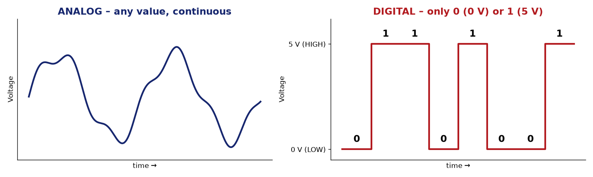
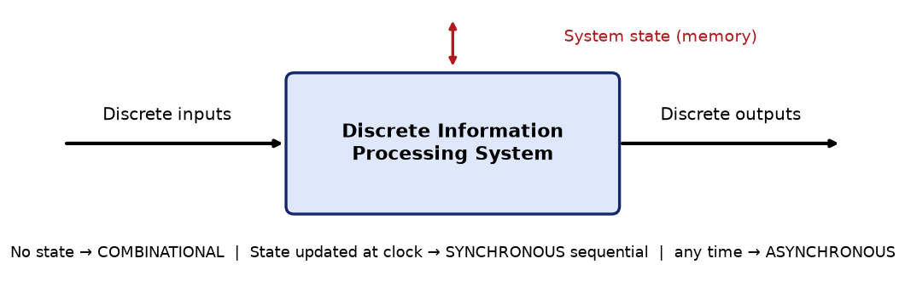
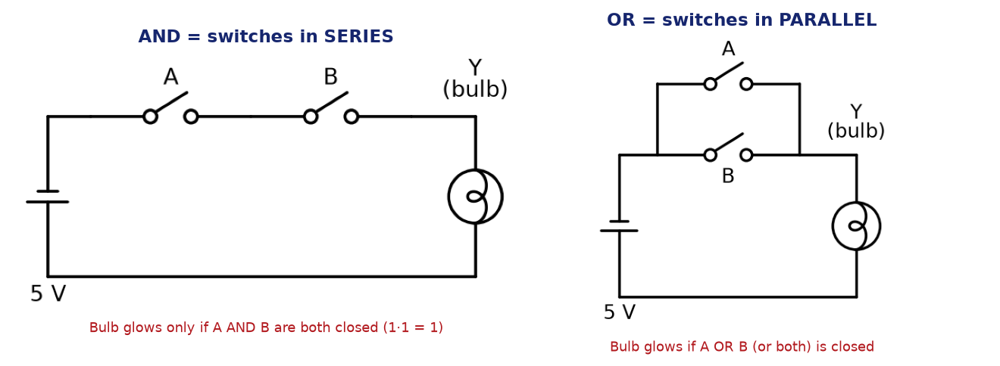
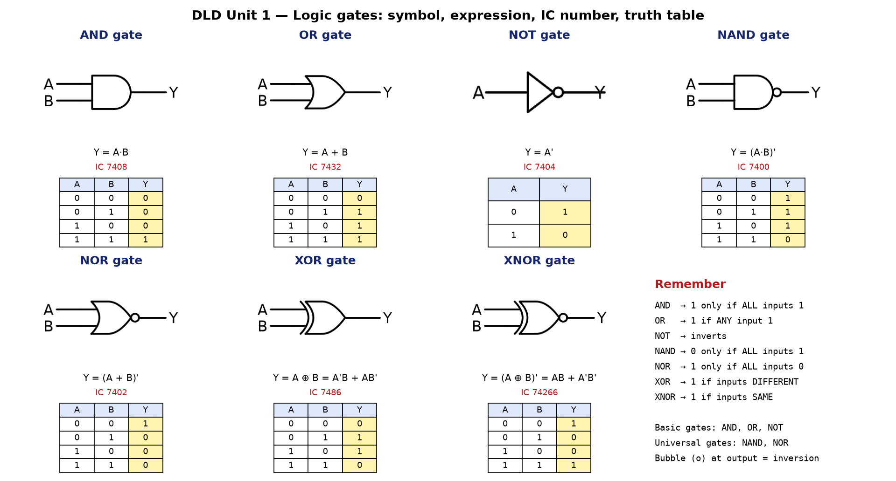
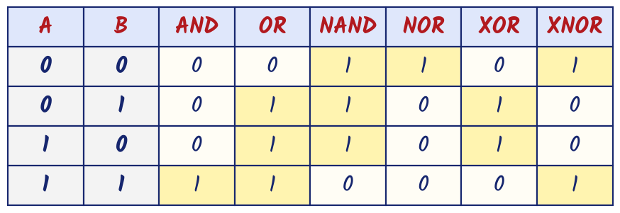
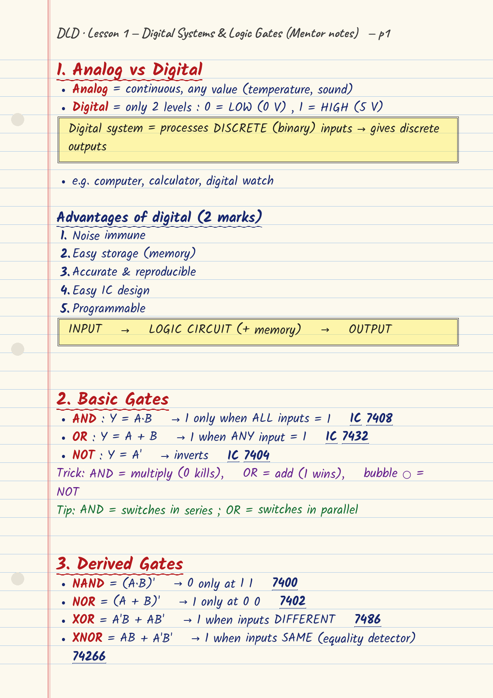
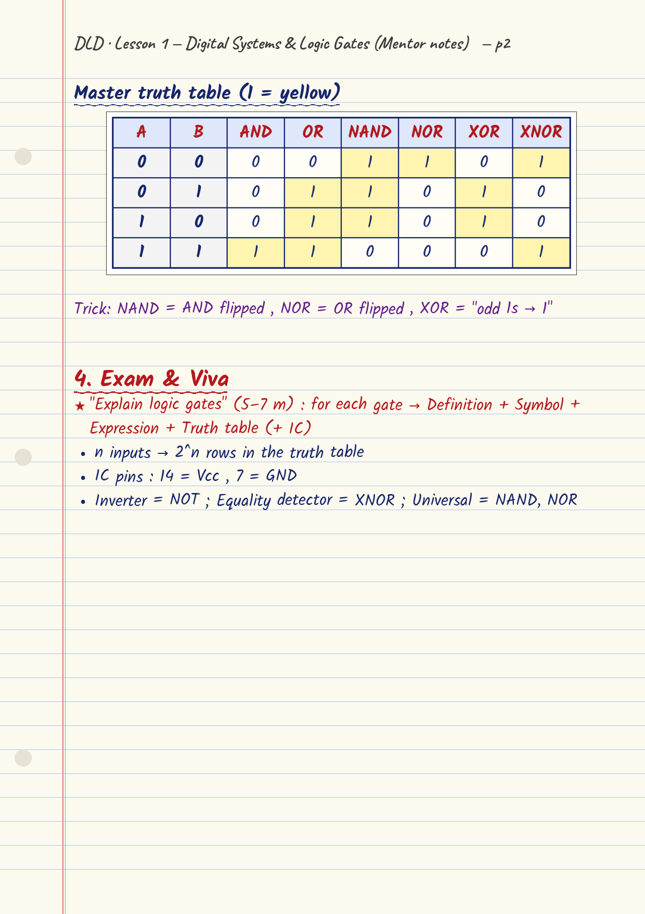

# DLD · Lesson 1 — Digital Systems & Logic Gates

> 🎯 **Aaj ka goal:** by the end you should be able to (1) define a digital system, (2) draw all 7 gates with their **symbol + expression + truth table + IC number**, and (3) answer the viva one-liners.
> ⏱ Time: ~45 min · Source: Unit-1 PPT slides 1–23 + class handwritten notes pp. 1–3 · Exam weight: ⭐ asked almost every year (5–7 marks)

---

## 1. Analog vs Digital — the basic difference

Left: an analog signal can take ANY value. Right: a digital signal is only 0 or 1.

**Simple language mein:**
- **Analog** = a dimmer knob 🎚️. The voltage changes smoothly and can take any value (temperature, sound, a mercury thermometer).
- **Digital** = a light switch 💡. Only **two states**: **0 = LOW ≈ 0 V** and **1 = HIGH ≈ 5 V**.

Because there are only 2 levels, a little noise can't turn a 0 into a 1. That's why the whole computer world is digital.

| | Analog | Digital |
|---|---|---|
| Values | Continuous (infinite) | Discrete (0 and 1) |
| Noise effect | High | Very low |
| Storage | Difficult | Easy (memory) |
| Example | Thermometer, old radio | Computer, calculator, digital watch |

## 2. What is a digital system?

> ✍️ **Exam definition (1–2 marks):** *A digital system is a system that accepts discrete (binary) inputs, processes them using logic circuits (and stored information, i.e. its state), and produces discrete outputs.* Examples: computer, calculator, digital watch.

**Advantages of digital systems (2–3 marks; write any 4–5):**
1. Less affected by noise (noise immunity)
2. Information can be stored easily (memory)
3. Accurate and reproducible: the same input always gives the same output
4. Easy to design and fabricate using ICs; small and cheap
5. Programmable (the same hardware can do different jobs)

---

## 3. Logic gates — the building blocks

A **logic gate** is an electronic circuit with one or more binary inputs and **one** binary output. The output follows a fixed logical rule.

### The intuition: switches and a bulb

- **AND** = two switches in **series**. The bulb glows only when **A AND B** are both ON.
- **OR** = two switches in **parallel**. The bulb glows when **A OR B** (or both) is ON.
- **NOT** = an opposite switch. Press it and the light goes off.

### All 7 gates: symbol + expression + truth table + IC

| Gate | Expression | Rule in one line | IC |
|---|---|---|---|
| **AND** | Y = A·B | 1 only when **all** inputs are 1 | 7408 |
| **OR** | Y = A + B | 1 when **any** input is 1 | 7432 |
| **NOT** | Y = A' | Inverts the input | 7404 |
| **NAND** | Y = (A·B)' | AND + NOT → 0 only when all inputs are 1 | 7400 |
| **NOR** | Y = (A+B)' | OR + NOT → 1 only when all inputs are 0 | 7402 |
| **XOR** | Y = A⊕B = A'B + AB' | 1 when the inputs are **different** | 7486 |
| **XNOR** | Y = (A⊕B)' = AB + A'B' | 1 when the inputs are **same** (equality detector) | 74266 |

### The master truth table (remember it as one picture)

🧠 **Tricks to remember:**
- **AND = multiplication** → a 0 anywhere makes the output 0 ("0 kills").
- **OR = addition** → a 1 anywhere makes the output 1 ("1 wins").
- **Bubble ○ = NOT.** So NAND is the AND column flipped, and NOR is the OR column flipped.
- **XOR = "odd number of 1s → 1"**, and XNOR is its opposite.
- **n inputs → 2ⁿ rows** (2 inputs → 4 rows, 3 inputs → 8 rows).

---

## 4. How to write it in the exam

**Q: "Explain various logic gates with symbol and truth table." (7 marks)**
Write a block for **every gate** in this order (≈1 mark per gate):
1. **Definition** (1 line)
2. **Symbol** (neat, labelled A, B, Y)
3. **Boolean expression**
4. **Truth table**
5. *(Bonus)* IC number

Start with a 1-line intro ("Logic gates are the basic building blocks of digital circuits…"). End with: *"NAND and NOR are called universal gates."* That last line leads into the next lesson and impresses the examiner.

**Viva one-liners 🎤**

| Question | Answer |
|---|---|
| Which gate is the inverter? | NOT |
| Which gate is the equality detector? | XNOR |
| Which gates are universal? | NAND and NOR |
| IC for NAND? NOR? | 7400, 7402 |
| Vcc and GND pins of a 14-pin IC? | Pin 14 = Vcc, pin 7 = GND |
| Logic levels in TTL? | 0 ≈ 0 V, 1 ≈ 5 V |

---

## 5. Your handwritten notes for this lesson (revise from these)

---

## ✅ Check yourself — reply to your mentor in chat

1. How many rows does a **3-input AND gate** truth table have, and in how many rows is the output 1?
2. If **A = 1, B = 1**, what is the output of NAND, NOR, XOR and XNOR?
3. Which gate gives **1 when the inputs are different**? Write its Boolean expression.
4. *(Viva)* Why is digital better than analog? Give 2 reasons.

🔒 Answers (open only after you have written yours)

1. 2³ = **8 rows**; the output is 1 in **only 1 row** (A = B = C = 1).
2. NAND = **0**, NOR = **0**, XOR = **0**, XNOR = **1**.
3. **XOR**: Y = A⊕B = A'B + AB'.
4. Any two of: noise immunity, easy storage, accuracy, easy IC design, programmable.

**Next → Lesson 2: Universal gates (building NOT, AND, OR and XOR from only NAND or only NOR).**
